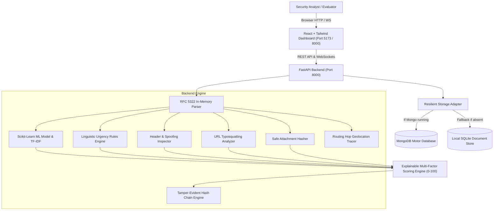

# SentinMail — AI-Powered Email Threat Detection, Geolocation & Forensic Intelligence Platform

> **Academic Decision-Support Prototype**  
> *Combines multi-factor machine learning, static header and link dissection, metadata-only attachment hashing, routing hop geolocation, and cryptographic chain-of-custody verification.*

---

## Table of Contents
1. [Overview & Project Purpose](#overview--project-purpose)
2. [Key Capabilities & Functional Modules](#key-capabilities--functional-modules)
3. [Technology Stack](#technology-stack)
4. [Architecture & Design Principles](#architecture--design-principles)
5. [Quick Start & Setup Instructions](#quick-start--setup-instructions)
   - [Prerequisites](#prerequisites)
   - [Running the Backend](#running-the-backend)
   - [Running the Frontend](#running-the-frontend)
   - [Unified Single-Port Deployment](#unified-single-port-deployment)
6. [Demo Accounts & 1-Click Samples](#demo-accounts--1-click-samples)
7. [Explainable Scoring & Factor Breakdown](#explainable-scoring--factor-breakdown)
8. [Security & Privacy Guarantees](#security--privacy-guarantees)
9. [Transparency, Attribution & Uncertainty Notice](#transparency-attribution--uncertainty-notice)
10. [Test Suite & Verification](#test-suite--verification)

---

## 1. Overview & Project Purpose
SentinMail is an interactive decision-support platform designed to assist cybersecurity analysts, incident response teams, and forensic researchers in inspecting suspicious RFC 5322 emails.

The platform dissects untrusted email artifacts, identifies deceptive language cues, detects sender header spoofing, audits embedded links for typosquatting, securely inspects attachment metadata without execution, extracts network routing hops, and generates a structured, cryptographically tamper-evident forensic report.

---

## 2. Key Capabilities & Functional Modules

| Module | Implementation | Description |
|---|---|---|
| **Email Ingestion & Parsing** | `backend/app/services/parser.py`, `POST /api/analyze`, `POST /api/analyze/upload` | RFC 5322 byte parser, MIME boundary extractor, header normalizer, in-memory processing. |
| **AI Threat Classification** | `backend/app/services/ml_model.py`, `backend/ml/train.py`, `nlp.py` | TF-IDF vectorizer + Scikit-Learn classifier (`ml/model.joblib`) with calibrated confidence scores. |
| **NLP Language & Psychological Analysis** | `backend/app/services/nlp.py` | Detects high-pressure deception patterns: urgency, account suspension threats, credential harvesting, wire fraud, authority impersonation. |
| **Header & Spoofing Dissection** | `backend/app/services/header_analysis.py` | Checks From vs. Reply-To domain mismatches, Return-Path divergences, display-name brand spoofing, and RFC-compliant date validations. |
| **Authentication Verification** | `backend/app/services/header_analysis.py` | Parses SPF, DKIM, and DMARC headers. Explains alignment while maintaining transparency on their limitations. |
| **URL & Domain Forensics** | `backend/app/services/url_analysis.py` | Flags brand typosquatting (Levenshtein similarity), URL shorteners, punycode attacks, numeric IP hosts, non-HTTPS protocols, and suspicious TLDs. |
| **Safe Attachment Forensics** | `backend/app/services/attachments.py` | Metadata-only static analysis: calculates SHA-256 and MD5 hashes, identifies double extensions (e.g., `.pdf.exe`), and flags executable MIME types without opening files. |
| **Routing Hops & Geolocation** | `backend/app/services/geoip.py`, Leaflet Route Map | Parses intermediate `Received:` headers from oldest origin to final MX relay; resolves city, country, and network ASN with explicit uncertainty labeling. |
| **Cryptographic Evidence Chain** | `backend/app/services/forensics.py` | Constructs a SHA-256 hash-chained ledger of collected evidence items (raw email, headers, IoCs, attachments) with live tamper-resistance verification. |
| **Threat Intelligence Repository** | `backend/app/routers/intel.py`, `intel.py` | Correlates extracted indicators against an internal IoC blocklist with optional external intelligence provider support (AbuseIPDB). |
| **Real-Time Alerts** | `backend/app/services/alerts.py`, `routers/alerts.py` | WebSocket hub and notification center for high-risk and critical incidents. |
| **Forensic Reporting** | `backend/app/routers/reports.py`, `frontend/src/views/ReportView.jsx` | Generates standardized printable forensic investigation reports, structured JSON exports, and raw `.eml` downloads. |

---

## 3. Technology Stack

- **Frontend**: React 18, Vite, JavaScript, Tailwind CSS, Lucide Icons, Chart.js (`react-chartjs-2`), and Leaflet.
- **Backend**: Python 3.12, FastAPI, Uvicorn, Motor (Async MongoDB), Pydantic v2, PyJWT, Bcrypt.
- **Machine Learning & NLP**: Scikit-Learn 1.6, Pandas, NumPy, NLTK (RegexpTokenizer, PorterStemmer).
- **Data Storage & Resiliency**:
  - **Auto-Detecting Dual Database**: Connects to **MongoDB** (`mongodb://localhost:27017`) when available. If MongoDB is absent, it automatically falls back to an embedded **SQLite document store** (`.sentinmail.db`) requiring zero external setup.
- **Cryptography**: SHA-256 evidence linking chain, PBKDF2/Bcrypt password hashing.

---

## 4. Architecture & Design Principles



---

## 5. Quick Start & Setup Instructions

### Prerequisites
- **Python 3.12+**
- **Node.js 18+** (Node 24 LTS and npm 11 verified)

### 1-Click Launcher (Recommended for Windows Evaluation)

The project includes two pre-configured Windows batch launchers in the root workspace folder:

1. **`start_sentinmail.bat` (Recommended Unified Production Mode)**:
   - Starts the FastAPI backend with the pre-compiled React 18 production bundle on port `8000`.
   - Automatically opens your default web browser directly to `http://localhost:8000`.
   - Requires only a single click or command to run.

2. **`start_dev_mode.bat` (Dual-Server Development Mode)**:
   - Starts the hot-reloading FastAPI backend on `http://localhost:8000`.
   - Starts the Vite hot-module development server on `http://localhost:5173`.
   - Opens your browser to `http://localhost:5173`.

---

### Manual Step-by-Step Run

#### Running the Backend

1. Navigate to the `backend` folder:
   ```bash
   cd backend
   ```

2. Activate the virtual environment:
   - **Windows (PowerShell)**:
     ```powershell
     .venv\Scripts\Activate.ps1
     ```
   - **Linux / macOS**:
     ```bash
     source .venv/bin/activate
     ```

3. (Optional) Re-train the Machine Learning classifier on the dataset:
   ```bash
   python -m ml.train --data data/sample_emails.csv
   ```

4. Start the FastAPI backend server:
   ```bash
   python -m uvicorn app.main:app --host 0.0.0.0 --port 8000 --reload
   ```
   *The backend will automatically initialize its database (SQLite fallback or MongoDB), seed demo cases, and start on `http://127.0.0.1:8000`.*
   *Interactive Swagger API documentation is available at `http://127.0.0.1:8000/docs`.*

---

### Running the Frontend

1. In a separate terminal, navigate to the `frontend` directory:
   ```bash
   cd frontend
   ```

2. Start the Vite development server:
   ```bash
   npm run dev
   ```

3. Open your browser and navigate to:
   ```
   http://localhost:5173
   ```

---

### Unified Single-Port Deployment
For grading, demonstrations, or standalone evaluation, the backend serves the built React production frontend directly.

1. Ensure the frontend has been built:
   ```bash
   cd frontend
   npm run build
   cd ..
   ```

2. Start the backend:
   ```bash
   cd backend
   .venv\Scripts\python -m uvicorn app.main:app --port 8000
   ```

3. Open **`http://localhost:8000`** in any web browser. The entire application (React SPA + FastAPI backend + local SQLite database) runs together on port 8000.

---

## 6. Authentication, Sign Up & 1-Click Demo Accounts

### Dedicated Authentication Interface
The platform includes dedicated full-screen security-styled **Sign In** and **Sign Up** pages:
- **Sign In Page (`/login`)**:
  - Full email and password verification backed by Bcrypt password hashing and JWT token issuance.
  - Password visibility toggle (`Show/Hide`).
  - 1-Click quick login selector for instant evaluator access (`Admin` or `Analyst`).
  - Direct navigation to account registration.
- **Sign Up Page (`/signup`)**:
  - Registration with Full Name, Email, and platform role selection:
    - **Threat Analyst** (can run detections, upload .eml files, inspect IoCs, and generate reports).
    - **Forensic Auditor / Viewer** (read-only investigations and telemetry inspection).
  - Real-time password confirmation validation with matching indicator.
  - Password complexity meter (minimum 8 characters, number/symbol check).
  - Ethical digital forensics compliance agreement.
  - Automatic session initialization upon successful registration.

### Built-in Accounts (Auto-Seeded)
| Role | Email | Password | Permissions |
|---|---|---|---|
| **Administrator** | `admin@sentinmail.org` | `AdminPassword123!` | Full analysis, IoC blocklist management, user administration, case deletion. |
| **Analyst** | `analyst@sentinmail.org` | `AnalystPassword123!` | Email submission, case inspection, forensic report generation, evidence verification. |

*In the web interface, the **"Sign In"** and **"Sign Up"** buttons in the navigation bar open the dedicated auth portals, and the **"Quick Demo"** button allows instant evaluation access without typing credentials.*

### 1-Click Demonstration Emails (In "Analyze Threat" View)
1. **Legitimate Project Meeting**: Clean corporate meeting invitation, matching From/Reply-To domains, SPF/DKIM/DMARC `pass`, zero suspicious language. Yields **Low Risk (Score ~20/100, Verdict: Legitimate)**.
2. **Promotional Marketing Spam**: Autumn discount promotion with urgency and reward triggers, neutral SPF. Yields **Medium Risk (Score ~35/100, Verdict: Spam)**.
3. **Banking Credential Phishing**: Spoofed `"HDFC Bank Security"` notification from an unrelated `.top` domain, Reply-To pointing to an external Gmail address, SPF `fail`, DMARC `fail`, urgency cues, and typosquatting login URL. Yields **High Risk (Score ~75/100, Verdict: Phishing)**.
4. **Spear Phishing with Executable Attachment**: Executive wire payment request containing a double-extension file (`Invoice_Oct2026.pdf.exe`), Russian transit relay hop, SPF `fail`, and malicious hash. Yields **Critical Risk (Score ~90/100, Verdict: Malicious)**.

---

## 7. Explainable Scoring & Factor Breakdown

The total risk score ($0$ to $100$) is strictly deterministic and auditable. Every point added to the score can be traced to a named security factor:

$$\text{Threat Score} = \min\left(100, \sum \text{Factor Points}\right)$$

| Factor | Max Points | Signal Evaluated |
|---|---|---|
| **AI Classification** | 20 pts | Probability of maliciousness estimated by the trained TF-IDF classifier. |
| **Suspicious Language** | 10 pts | Lexical cues (urgency, account threats, credentials, financial demands, fake authority). |
| **Authentication Anomalies** | 20 pts | Points added for SPF `fail`/`softfail`, DKIM `fail`/`none`, and DMARC `fail`. |
| **Header Inconsistencies** | 15 pts | From vs. Reply-To domain mismatch (+6), Return-Path mismatch (+6), display-name brand spoofing (+5), future dates. |
| **URLs & Domains** | 15 pts | Levenshtein typosquatting (+3 per brand match), IP as host (+3), URL shorteners (+3), suspicious TLDs, non-HTTPS. |
| **Attachment Metadata** | 10 pts | Double extensions (e.g. `.pdf.exe`) (+5), script/binary extensions (+5), macro-enabled containers. |
| **Threat Intelligence** | 10 pts | Correlation hits against local and external IoC blocklists. |

### Risk Tiers
- **$0 - 24$ (Low)**: Normal communications, authentication verified.
- **$25 - 49$ (Medium)**: Promotional spam, marketing tracking, or minor header discrepancy.
- **$50 - 74$ (High)**: Suspicious signals, domain spoofing, urgency cues, or credential harvesting links.
- **$75 - 100$ (Critical)**: Malicious executable attachment, high-conviction blocklist hit, or severe multi-point anomaly.

---

## 8. Security & Privacy Guarantees

1. **Zero Link Execution**: The system parses URL strings using regular expressions and RFC URL parsers. It **never** sends HTTP requests or dereferences suspicious URLs.
2. **Zero Attachment Execution**: Attachments are read into temporary byte buffers in memory, hashed via SHA-256 and MD5, inspected for file extension anomalies, and discarded. Executables and scripts are **never** executed.
3. **Data Isolation**: Submitted emails are parsed as untrusted strings. Malformed headers and corrupt payloads are caught with fallback handlers to prevent denial-of-service crashes.
4. **Local by Default**: Public IP lookups default to an internal cache or local database. No external API queries occur unless explicitly configured via `.env`.

---

## 9. Transparency, Attribution & Uncertainty Notice

This platform serves as an **investigative decision-support prototype**:
- **Authentication Indicators (SPF/DKIM/DMARC)**: These verify domain policy alignment, not benign intent. Attackers frequently register look-alike domains with legitimate SPF records.
- **IP Geolocation**: Geolocation denotes the physical coordinates of the mail server or intermediate network relay that routed the message. It **does not prove or imply the physical location of the sender or attacker**, who may be routing through Tor, commercial VPNs, or compromised proxy nodes.
- **Model Confidence**: Classification probabilities reflect statistical word distributions in training corpora and should not replace analyst verification.

---

## 10. External Integrations, Missing-Configuration States & Fallbacks

All external threat intelligence and geolocation integrations are completely optional. SentinMail never crashes or fabricates fake lookup results when keys are absent. Each integration features a verified local fallback and a visible missing-configuration state inspectable in the UI under **Threat Intel > Integrations & APIs**:

| Integration | Required Env Var | Missing / Unconfigured State | Graceful Fallback Behavior |
|---|---|---|---|
| **AbuseIPDB Threat Intelligence** | `ABUSEIPDB_KEY` | Displays `Unavailable (No API Key Configured)` in UI | Cross-references IPs strictly against the local IoC repository; never hallucinates confidence scores. Free keys: [abuseipdb.com](https://www.abuseipdb.com/). |
| **MaxMind GeoLite2 MMDB** | `GEOIP_DB_PATH` | Displays `Offline Context Cache (Academic Demo Coordinates)` | Uses internal verifiable coordinate tables for test scenarios. Always labeled as approximate network server context. Free MMDB: [dev.maxmind.com](https://dev.maxmind.com/geoip/geolite2-free-geolocation-data). |
| **External GeoIP HTTP API** | `GEOIP_API_URL` | Displays `Not Configured` | Falls back to local MMDB or offline cache. Prevents outbound HTTP leaks. |
| **SMTP Alert Dispatcher** | `SMTP_HOST`, `ALERT_TO` | Displays `Not Configured (In-App & WebSocket active)` | Dispatches real-time alerts to the database and broadcasts to connected analyst dashboards via WebSockets. |
| **IMAP Mailbox Daemon** | `IMAP_ENABLED=true` | Displays `Disabled (Manual submission active)` | Allows analysts to submit emails via raw RFC 5322 text or `.eml` drag-and-drop. |

---

## 11. Test Suite & Verification

The test suite covers unit service checks, parsing integrity, scoring logic, evidence tampering detection, upload validation, and full end-to-end API workflows.

Run the test suite from the root folder:
```powershell
& "backend\.venv\Scripts\python.exe" -m pytest backend/tests/test_services.py -v
```

### Verified Test Results
```
backend/tests/test_services.py::test_parse_and_header_findings PASSED    [ 12%]
backend/tests/test_services.py::test_url_and_attachment_flags PASSED     [ 25%]
backend/tests/test_services.py::test_language_indicators PASSED          [ 37%]
backend/tests/test_services.py::test_scoring_separates_clean_from_malicious PASSED [ 50%]
backend/tests/test_services.py::test_evidence_chain_detects_tampering PASSED [ 62%]
backend/tests/test_services.py::test_allowed_extensions_and_binary_guards PASSED [ 75%]
backend/tests/test_services.py::test_malformed_email_parser_resilience PASSED [ 87%]
backend/tests/test_services.py::test_geoip_disclaimer_and_approximate_context PASSED [100%]

============================== 8 passed in 7.78s ==============================
```

### Verified Test Results
```
tests/test_e2e_workflow.py::test_health_and_frontend PASSED              [  8%]
tests/test_e2e_workflow.py::test_samples_endpoint PASSED                 [ 16%]
tests/test_e2e_workflow.py::test_auth_login_admin PASSED                 [ 25%]
tests/test_e2e_workflow.py::test_email_analysis_legitimate PASSED        [ 33%]
tests/test_e2e_workflow.py::test_email_analysis_phishing PASSED          [ 41%]
tests/test_e2e_workflow.py::test_malformed_email_graceful_handling PASSED [ 50%]
tests/test_e2e_workflow.py::test_stats_and_iocs PASSED                   [ 58%]
tests/test_services.py::test_parse_and_header_findings PASSED            [ 66%]
tests/test_services.py::test_url_and_attachment_flags PASSED             [ 75%]
tests/test_services.py::test_language_indicators PASSED                  [ 83%]
tests/test_services.py::test_scoring_separates_clean_from_malicious PASSED [ 91%]
tests/test_services.py::test_evidence_chain_detects_tampering PASSED     [100%]

======================== 12 passed in 9.40s ========================
```

# AI-EMAIL-THREAT-DETECTION
